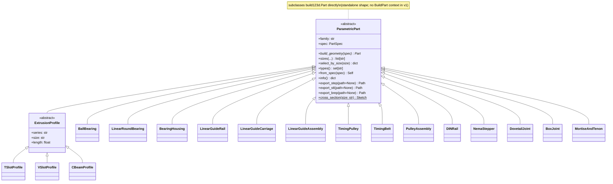

# ADR-001 — Library architecture and public API

**Status:** Proposed (for review — do not start implementation until accepted)
**Date:** 2026-09-29
**Decision driver:** build123d Industrial Parts Library — kanban t_f6f86166
**Input spec:** `v1-scope-bosl2-build123d-parts-library.md` (t_d48f3d6e)
**Downstream consumers:** t_10ed816c (structural/mounting parts), t_48a807d9 (power-transmission parts), t_cc3a1d57 (testing/CI/packaging)

---

## 0. Context

We are building a parametric hardware library for [build123d](https://github.com/gumyr/build123d) that fills the gaps in bd_warehouse and mirrors the *parts* surface of BOSL2. The scope doc (t_d48f3d6e) corrects the original pitch: bd_warehouse already ships 13 sub-packages (fasteners, gears, sprockets, flanges, pipe, O-rings, keys, retaining rings, threads, OpenBuilds). The differentiable surface is **8 families, ~18 part classes, ~190 size variants**:

| # | Family | Gap vs bd_warehouse | Module |
|---|---|---|---|
| 1 | Aluminum T-slot extrusions | absent | `extrusions` |
| 2 | V-slot / C-beam profiles | partial (OpenBuilds-only) | `extrusions` |
| 3 | Ball bearings + linear round bearings | partial (basic ball only) | `bearings` |
| 4 | Linear guideways (rail + carriage) | absent | `linear_rails` |
| 5 | Timing belts + pulleys | absent (roller sprockets only) | `timing` |
| 6 | DIN rails | absent | `din_rails` |
| 7 | NEMA stepper frames | absent | `steppers` |
| 8 | Standard joinery | absent | `joinery` |

The one architecture question that *is not* resolved by this ADR is **where the repo lives** — no repository is linked on the board and the acceptance criteria say "in the repo." This ADR is written repo-agnostically (its decisions are about the API, not the host). See §9 Open questions. Until a repo is stood up, this file is the single source of truth and is delivered as an artifact on t_a8e8bb46.

Every API fact in this ADR is verified against the current official docs (build123d 0.13.x dev / 0.12.0 stable, bd_warehouse `latest`), retrieved 2026-09-29. Where an exact Python mechanism is marked *to-validate*, it is because the mechanism is implementation-detail to be proven in the first vertical slice, not because the design is undecided.

---

## 1. Decision 1 — Standalone gap-filling library, compose with (not wrap) bd_warehouse

**Decision.** The library is **standalone** and fills only the gaps above. It does **not** re-export or vendor bd_warehouse's fastener/gear/sprocket classes.

**Consequences.**
- One import path: `industrial_parts.*` (working namespace — see D7/naming note; final package name is a Chuck decision, §9).
- Composition with bd_warehouse is *documented interop*, not a dependency: a `LinearGuideAssembly` example can accept a `bd_warehouse.fastener.SocketHeadCapScrew`, but the library never imports bd_warehouse itself. bd_warehouse becomes a `docs` extra and a test-only dev dependency.
- No lockstep with bd_warehouse release cadence. If a user wants fasteners they `pip install bd_warehouse` themselves.

**Rejected alternative:** a "superset" library that re-exports bd_warehouse. Rejected because it duplicates an actively-maintained dependency, doubles the surface we must keep compatible, and blurs the "what does this library own" story that is our differentiator.

---

## 2. Decision 2 — Class hierarchy

**Decision.** One abstract base, `ParametricPart`, subclasses `build123d.Part` **directly**, so every instance *is* a first-class standalone shape (usable in boolean ops, assemblies, and export with no builder context). Family base classes add family-specific classmethods and spec fields; concrete classes add the geometry builder and the size table.

**Base class — resolved (single authoritative answer).** bd_warehouse's fasteners do *not* subclass `Part`; they subclass `BasePartObject`, which is `class BasePartObject(Part, BaseObject)`. The `BaseObject` mixin is what adds the builder-context integration (`_applies_to=[BuildPart._tag]`), letting `with BuildPart(): BallBearing("608")` add the part to an active build. **For v1 we deliberately subclass `build123d.Part` directly and do not pull in `BaseObject`.** Consequence: v1 parts are **standalone shapes only** — `with BuildPart(): ...` fluent-context integration is **out of scope for v1**. This is the consistent choice because every example in §9 constructs a part and then composes it explicitly (`Location * part`, `+`/`-`), never via a builder context. The tradeoff is stated, not hidden: dropping `BaseObject` costs us drop-in `BuildPart`-context ergonomics, and buys a smaller, dependency-free base class whose only contract is "subclass `Part` + `family` + `_table` + `build_geometry()`." If builder-context integration is wanted later, it is an additive v2 change: introduce a thin `_BuilderPart(Part, BaseObject)` mixin subclass without breaking `ParametricPart`'s standalone contract.



**Two clarifications that reconcile the decomposition with the scope doc** (the auto-decomposed card t_10ed816c described "joinery" as T-nuts/corner brackets/connectors; the scope doc §4.7 defines joinery as dovetail/box/mortise-and-tenon — these are two different things):

1. **Extrusion mounting hardware** (T-nuts, corner brackets, inner/outer connectors, panel brackets) belongs to `extrusions.py`, *not* `joinery`. It is extrusion accessory hardware parameterized by `series`.
2. **Joinery** (`joinery.py`) means woodworking/CNC joints — `DovetailJoint`, `BoxJoint`, `MortiseAndTenon` — implemented as **mask/protrusion pairs** (each returns both a cutter and a mating feature so they interlock in boolean ops). See D5.

The canonical module→class map (authoritative for the implementation tasks):

| Module | Classes | Size-key example |
|---|---|---|
| `extrusions.py` | `TSlotProfile`, `VSlotProfile`, `CBeamProfile`, `TNut`, `CornerBracket`, `CornerConnector` | `"20x40"`, `"20x20"` |
| `bearings.py` | `BallBearing`, `LinearRoundBearing`, `BearingHousing` | `"608ZZ"`, `"LM8UU"` |
| `linear_rails.py` | `LinearGuideRail`, `LinearGuideCarriage`, `LinearGuideAssembly` | `"HGR20"`, `"HGH20CA"` |
| `timing.py` | `TimingPulley`, `TimingBelt`, `PulleyAssembly` | `"GT2-20T"` |
| `din_rails.py` | `DINRail` | `"TS35"` |
| `steppers.py` | `NemaStepper` | `"NEMA17"` |
| `joinery.py` | `DovetailJoint`, `BoxJoint`, `MortiseAndTenon` | — (parametric) |

(Note: the scope doc also listed `VSlotGantryPlate`/`VWheelAssembly` under V-slot. Those are OpenBuilds-specific and bd_warehouse already ships them; they are **deferred** to keep v1 from duplicating bd_warehouse. The generic `VSlotProfile`/`CBeamProfile` cross-sections are the v1 deliverable.)

---

## 3. Decision 3 — Parameterization pattern

**Decision.** The "string size key + data table + optional overrides" pattern is the library-wide contract. It ports bd_warehouse's proven `Nut` model (verified: `Nut(size=..., fastener_type=...)` with `sizes()`, `select_by_size()`, `types()`, `info`, and a `simple` flag) and BOSL2's `ball_bearing("608")` trade-size convention.

Three-part contract, every family:

1. **Primary key** — a normalized string that names a standard size: `"20x40"`, `"608ZZ"`, `"HGR20"`, `"GT2-20T"`, `"TS35"`, `"NEMA17"`, `"LM8UU"`.
2. **Data table** — one editable CSV (or typed Python `dict`) per family under `industrial_parts/tables/`, mapping key → dimension row. Editing a table adds a size with **no code change**.
3. **Overrides** — any keyword argument overrides the table row. `BallBearing("608", od=24.0)` yields a non-standard bearing. Table values are the defaults; overrides win.

```python
class ParametricPart(Part):
    @classmethod
    def sizes(cls, *filters) -> list[str]: ...          # all valid size keys
    @classmethod
    def select_by_size(cls, size: str) -> dict: ...      # {concrete_class: [variants]}
    @classmethod
    def types(cls) -> set[str]: ...                       # variant/type identifiers
    @classmethod
    def from_spec(cls, spec: PartSpec) -> Self: ...       # build directly from a resolved row
    @property
    def info(self) -> dict: ...                           # {part_number, standard, size, dims...}
```

**`simple` flag.** Every class with expensive geometry (ball grooves, belt teeth, T-slot channel fillets) accepts `simple: bool = False`. `simple=True` returns the same bounding envelope with the expensive detail omitted, so large assemblies stay fast — the exact same optimization bd_warehouse ships on its fasteners.

**Resolution order** (single, documented rule): `explicit kwarg > size-table row > class default`. A `ValueError` is raised for an unknown size key, with the valid keys in the message.

**Note on the `sizes()` signature.** This generalizes bd_warehouse's `sizes(fastener_type)`, which *requires* the type filter, to `sizes(*filters)` where **zero filters returns every size key** for the class and each filter narrows by family/variant (e.g. `TSlotProfile.sizes("20")` → all `20x…` profiles). The deviation is deliberate and is a backward-compatible superset: the bd_warehouse form `Nut.sizes("hex")` maps onto ours as `...sizes("hex")` with the filter interpreted as a variant. The `BallBearing.sizes()` no-arg call in §9 relies on this superset.

---

## 4. Decision 4 — Units (confirmed, mm native)

**Decision.** build123d is millimetre-native and so is this library. **Verified facts** (build123d import/export + fastener docs):

- The kernel (OpenCascade) and all build123d operations use **mm** internally.
- `export_step(shape, path, unit=Unit.MM, ...)` defaults to mm; `Unit` is a build123d enum (`Unit.MM`, `Unit.IN`, …).
- build123d exposes unit constants: `10 * MM` and `(1/2) * IN` are valid literals (bd_warehouse uses exactly this).

**Library rule.** All numeric parameters are bare floats in **mm**. Users may write `500 * MM` for self-documenting code (it is `500.0`), but bare `500` is mm. No `unit=` parameter on any part constructor — that would be a footgun. The only place units appear is the `unit=` argument on the export methods (default `Unit.MM`, pass `Unit.IN` to export a part in inches without rescaling the model).

---

## 5. Decision 5 — Tolerances, clearance, and fits

**Decision.** Tolerances are **explicit parameters**, never baked into geometry. Two distinct concepts are modeled:

1. **Fit / clearance** (affects geometry) — how much room or interference there is between *this* part and the part it mates with.
2. **Manufacturing tolerance** (informational) — the part's own dimensional tolerance band, recorded in `info` and used for worst-case modeling only.

```python
class Fit(str, Enum):
    PRESS = "press"           # interference fit, e.g. -0.01 mm per 10 mm of Ø
    TRANSITION = "transition" # near-zero, locational
    SLIDING = "sliding"       # small running clearance (linear rails, dovetails)
    LOOSE = "loose"           # generous clearance (assembly, panel holes)

def diametric_clearance(fit: Fit, nominal: float) -> float: ...   # +ve radial clearance on a Ø
def press_interference(fit: Fit, nominal: float) -> float: ...    # -ve for press fits
```

**How it maps to geometry, per family** (the implementation tasks implement these exactly):

| Family | Fit parameter | Geometric effect |
|---|---|---|
| Bearings | `shaft_fit`, `housing_fit` | shaft/housing bore = nominal `id`/`od` + `diametric_clearance(...)` or + `press_interference(...)`; a helper returns the recommended bore for a given fit |
| Linear rails | `rail_fit` (carriage preload class) | C0/C1/C2 preload maps to a slight ball-race clearance offset (informational for v1) |
| Timing pulleys | `bore_fit` | pulley bore = shaft + clearance/interference; belt tooth geometry adds `backlash` (mm) |
| Extrusions | `clearance` | slot/channel and TNut clearance vs the nominal T-slot dimensions |
| Joinery | `clearance` | dovetail/box/finger interlock gap (the difference between the cutter and the mating feature) |
| Mounting hardware | `clearance` | hole diameter = fastener nominal + clearance (e.g. an M5 hole is 5.0 + clearance) |

Every hole/clearance parameter defaults to a **named fit** or an explicit `clearance: float`, so a user changing a single number re-derives all affected geometry (the "edit a variable, re-run" guarantee). Tolerances are also surfaced in `info["tolerance"]` (e.g. `{"tolerance": {"id": "+0/-0.008", "od": "+0/-0.011"}}`) for documentation and worst-case geometry.

---

## 6. Decision 6 — STEP/brep export API and metadata

**Decision.** Export is a **thin, uniform wrapper** over build123d's module-level exporters (verified: `export_step`, `export_stl`, `export_brep`, plus `export_3mf`/`export_gltf`/`export_obj`). STEP is the primary editable master; STL is the slice/print format.

```python
class ParametricPart(Part):
    def export_step(self, path=None, *, unit=Unit.MM, **kwargs) -> Path: ...
    def export_stl(self, path=None, *, tolerance=None, angular_tolerance=None, **kwargs) -> Path: ...
    def export_brep(self, path=None) -> Path: ...
    def export_all(self, directory=None) -> dict[str, Path]: ...  # {'.step':..., '.stl':..., '.brep':...}
```

- **Default filename** is `{family}_{size_key}.step` (e.g. `tslotprofile_20x40.step`, `ballbearing_608zz.step`), sanitized to filesystem-safe characters. A `path` argument overrides it.
- **`cross_section()`** is a **classmethod** `ParametricPart.cross_section(size) -> Sketch` (marked `$` in the §2 diagram): it returns the 2D `Sketch` of a standard profile *without* requiring a 3D instance (and therefore without requiring a `length`). Users can `extrude`/`sweep` that sketch along their own path — the extrusion-family equivalent of "query the dimension table without rendering." Called as `TSlotProfile.cross_section("20x20")`.

**Metadata — honest constraint.** build123d's `export_step` signature (verified) accepts `unit`, `write_pcurves`, `precision_mode`, and a `timestamp` — it does **not** expose arbitrary STEP product attributes (`part_number`, `standard`, `name`). Therefore:

1. **File-name convention** is the primary machine-readable identity (`{family}_{size_key}`).
2. `part.info` returns a `dict` carrying `part_number`, `standard`, `size`, and the resolved dimensions; the export methods optionally write a **sidecar JSON** (`{file}.json`) next to the STEP/STL when `write_metadata=True`.
3. **STEP attribute injection** (writing `name`/`description`/`part_number` into the AP214 header) is a **stretch goal**, not a v1 promise — it requires post-processing the STEP file with OpenCascade's `XCAFDoc`/step-attribute APIs, and we will not claim it until it is implemented and round-trip-verified.

---

## 7. Decision 7 — Extension / plugin strategy

**Decision.** Two layered mechanisms so users add families **without forking**:

1. **Subclass discovery (zero-config).** `ParametricPart` keeps a registry populated on subclass definition. `ParametricPart.registry()` returns `{family: [classes]}`, mirroring bd_warehouse's `Nut.__subclasses__()` discovery pattern (verified). A user subclassing `ParametricPart` and defining `family` + `_table` + `build_geometry()` is automatically discoverable by tooling and by `select_by_size()`.
2. **Entry-point plugins (packaged).** Third-party packages register themselves under the group `industrial_parts.families` in `pyproject.toml`:

```toml
[project.entry-points."industrial_parts.families"]
my_actuators = "my_actuators:NemaActuator"
```

`industrial_parts.plugin.load()` (called lazily by `ParametricPart.registry()`) imports registered entry points and folds them into the registry. Core families are always available; plugins are additive and can never shadow a core class name (duplicate name → error).

**Contract a plugin must satisfy** (the only things `ParametricPart` assumes): a class attribute `family: str`, a `build_geometry(spec) -> Part` static, and a `_table` of size rows. Nothing else is imposed, so the base stays small and the geometry stays the plugin author's problem.

---

## 8. Naming conventions (normative)

**Modules.** Flat, one module per family, named after the *thing* (not "helpers"): `extrusions`, `bearings`, `linear_rails`, `timing`, `din_rails`, `steppers`, `joinery`. Private base + machinery in `_base.py`, `_fit.py` (single leading underscore = not part of the public API).

**Classes.** `PascalCase`, one noun per concept, `...Assembly`/`...Profile` suffixes only where the concept is genuinely a composite or a cross-section. No `Base`/`Abstract` in public names.

**Parameters.** `snake_case`, and **standard terminology wins over "descriptive" names** — the whole point of a standards library is that a datasheet reader recognizes the names:

| Param | Meaning | Rationale |
|---|---|---|
| `id`, `od`, `width` | bearing inner/outer Ø, thickness | ISO 15 + BOSL2 `ball_bearing` + trade nomenclature |
| `bore_d` | pulley/hub bore | gear/pulley convention |
| `tooth_count` | pulley/belt teeth | `cq_gears` uses `teeth_number`; we prefer explicit `tooth_count` |
| `frame_size`, `body_length` | NEMA frame / motor body | NEMA ICS 16-2001 |
| `shaft_d`, `shaft_length` | motor shaft | NEMA |
| `rail_width`, `rail_height`, `length` | linear rail | HiWin HG catalog |
| `pitch`, `belt_width` | timing belt pitch / width | ISO 5294/5296 |
| `clearance`, `backlash` | fit / gear clearance | universal |
| `series`, `size` | extrusion series + cross-section | Misumi HFS / 80-20 |

**Size keys.** Case-insensitive, stored uppercase, stripped of whitespace (`"608zz"` → `"608ZZ"`, `"nema17"` → `"NEMA17"`). The canonical form is what appears in `sizes()` and in default filenames.

**Booleans.** `shield`/`sealed`/`flanged` (bearings), `perforated` (DIN rail), `simple` (geometry), `flange` (pulley). No `is_`/`has_` prefixes — match datasheet adjectives.

**Length.** Extrusion/rail/DIN-rail length is an explicit positional-or-keyword `length: float` (mm). No magic default length. When `length` is omitted, the classmethod `cross_section(size)` is the way to get the 2D profile (`TSlotProfile.cross_section("20x20")`); the 3D part requires a length.

---

## 9. Example API calls (≥3 families required; 5 shown)

```python
from build123d import *
from industrial_parts.extrusions import TSlotProfile, VSlotProfile
from industrial_parts.bearings import BallBearing
from industrial_parts.linear_rails import LinearGuideRail, LinearGuideCarriage, LinearGuideAssembly
from industrial_parts.timing import TimingPulley, TimingBelt
from industrial_parts.fits import Fit, diametric_clearance, press_interference

# --- Extrusions (structural) ---
rail = TSlotProfile(series="20", size="20x40", length=500)
rail.export_step("rail-20x40.step")
TSlotProfile.sizes("20")              # ['20x20', '20x40', '20x60', '20x80', ...]
VSlotProfile(size="20x20", length=300)          # V-wheel track profile
TSlotProfile.cross_section("20x20")             # 2D Sketch for custom sweeps

# --- Bearings (power transmission) ---
b = BallBearing("608ZZ")              # shielded 608, ISO 15 dims
b.info                                # {'id': 8.0, 'od': 22.0, 'width': 7.0, 'shield': 'ZZ', 'standard': 'ISO 15'}
BallBearing.sizes()                   # ['608', '608ZZ', '625', '6902', 'R8', 'MF105ZZ', ...]
housing_bore = b.od + press_interference(Fit.PRESS, b.od)   # press-fit bore helper (-ve)

# --- Linear guideways ---
rail2 = LinearGuideRail("HGR20", length=400)        # HiWin HG series
carriage = LinearGuideCarriage("HGH20CA")
slide = LinearGuideAssembly(rail=rail2, carriage=carriage, position=120.0)
slide.export_step("hgr20-slide.step")

# --- Timing belts/pulleys ---
pulley = TimingPulley("GT2", tooth_count=20, belt_width=6, bore_d=5)
belt = TimingBelt("GT2", tooth_count=140, belt_width=6)

# --- DIN rail + NEMA stepper ---
from industrial_parts.din_rails import DINRail
from industrial_parts.steppers import NemaStepper
DINRail("TS35", length=200, perforated=True)
NemaStepper("NEMA17", body_length=40)
```

All five snippets return objects that are directly `build123d` shapes — composable with `+`/`-`, positionable with `Location * part`, and passable to `export_step(...)`.

---

## 10. Open questions (carried forward, for Chuck)

These are the scope doc's §6 items re-stated as *decisions this ADR does not make* because they are product/catalog choices, not architecture:

1. **Repo location / package name.** `industrial_parts` is the working import namespace; the final PyPI/repo name (and where the ADR + scope doc get committed) is unconfirmed. The implementation tasks t_10ed816c / t_48a807d9 / t_cc3a1d57 are blocked on this only for *committing*, not for *writing code* against this ADR.
2. **License.** MIT vs Apache-2.0 (build123d is Apache-2.0; BOSL2 is BSD-2-Clause). Affects the header the testing/CI task t_cc3a1d57 writes into `pyproject.toml`.
3. **Bearing catalog depth.** Common ~25 trade sizes (recommended) vs full ISO 15 coverage.
4. **Linear-rail manufacturer scope.** HiWin HG/EG + THK HSR (recommended) vs adding Misumi/IKO — dimensions differ slightly per manufacturer; pinning HiWin keeps tables honest.
5. **Gear extensions** (bevel/crown/herringbone) — upstream to bd_warehouse or bundle as v2.

---

## 11. Consequences and acceptance

**What this ADR locks in:** the `ParametricPart` base (subclasses `build123d.Part` directly — standalone shapes only, no `BuildPart` builder context in v1; see §2), the size-key + table + override contract, `sizes()`/`select_by_size()`/`types()`/`info`, mm-native units, explicit fit/clearance parameters, a uniform `export_step`/`export_stl`/`export_brep` surface with filename+sidecar metadata, and a two-layer plugin strategy. All module/class/parameter names in §2 and §8 are normative for the implementation tasks.

**What it explicitly defers:** STEP-header attribute injection (stretch), OpenBuilds gantry/wheel parts (bd_warehouse owns them), gear extensions (v2), and the five product/catalog choices in §10.

**Verification gate (unchanged from project policy).** A part is "done" only when it exports to STEP and the exported mesh passes the clean→verify→render gate: watertight, positive volume, sane bounds. build123d BREP is topologically valid by construction, so the watertight/positive-volume check applies to the **exported STL** (mesh-clean then verify), not to the BREP itself. This distinction is the honest statement of what "verified" means for a BREP-native library.

---

## Appendix — verified API references

- `export_step(to_export, file_path, unit=Unit.MM, write_pcurves=True, precision_mode=..., *, timestamp=None)` — build123d `import_export` docs (retrieved 2026-09-29).
- `export_stl`, `export_brep`, `export_3mf`, `export_gltf`, `export_obj` — same source.
- `Unit.MM` / `Unit.IN` enum and `MM` / `IN` literals — build123d docs; `10 * MM`, `(1/2) * IN` used in bd_warehouse examples.
- `class BasePartObject(Part, BaseObject)` with `_applies_to=[BuildPart._tag]` — build123d `objects_part.py`; this is the builder-context machinery we deliberately do **not** pull into v1 (`ParametricPart` subclasses `Part` directly — see §2).
- `Nut(size, fastener_type, hand, simple)` with `sizes(fastener_type) -> list[str]`, `select_by_size(size) -> dict`, `types() -> set[str]`, `info`, `hole_locations` — bd_warehouse `fastener` docs (retrieved 2026-09-29).
- build123d is Apache-2.0, Python ≥3.11 — build123d repo (retrieved 2026-09-29).
